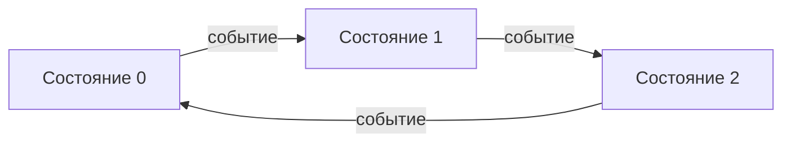
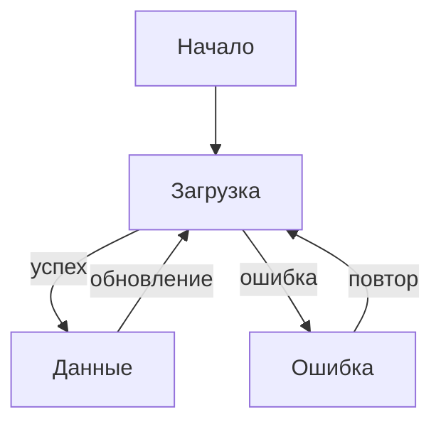
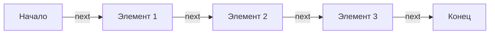

# AI конспект для лекции #25

## Что такое автомат

**Автомат (конечный автомат)** — это математическая модель, описывающая систему с конечным числом состояний и переходами между ними. Автомат находится в одном состоянии в каждый момент времени и переходит в другое состояние под воздействием внешних событий.



## Конечные автоматы для программистов

В программировании конечные автоматы используются для моделирования поведения систем с дискретными состояниями:

- **Парсеры** — разбор текста.
- **Сетевые протоколы** — состояния соединения.
- **UI-компоненты** — состояния загрузки, ошибки, успеха.
- **Игры** — состояния персонажа, уровни.
- **Регулярные выражения** — поиск по шаблону.



## Итераторы как автоматы

Итератор — это частный случай конечного автомата:

- **Состояния** — позиция в последовательности.
- **Переходы** — вызов `next()`.
- **Входной сигнал** — вызов `next()` (опционально с аргументом).
- **Выходной сигнал** — возвращаемое значение `{ value, done }`.



Итератор реализует **контракт получения данных**: потребитель запрашивает следующий элемент через `next()`, а производитель отдаёт его (или сообщает о завершении).

## Понятие потока данных

**Поток данных (stream)** — это последовательность данных, поступающих во времени. В отличие от коллекции (массива), где все данные уже есть в памяти, поток доставляет данные по мере их готовности.

```text
Коллекция: [1, 2, 3, 4, 5] — все элементы уже в памяти
Поток:    1 → 2 → 3 → 4 → 5 — элементы поступают последовательно
```

**Ключевые характеристики потока:**

- **Асинхронность** — данные могут поступать с задержкой.
- **Бесконечность** — поток может быть бесконечным.
- **Ленивость** — данные генерируются только по запросу.

## Преимущества поточного подхода

1. **Экономия памяти** — не нужно хранить все данные сразу.
2. **Работа с бесконечными последовательностями** — можно обрабатывать данные, не боясь переполнения памяти.
3. **Раннее начало обработки** — можно начать обработку, не дожидаясь завершения генерации.
4. **Композиция** — потоки можно соединять, фильтровать, трансформировать.

```javascript
// ❌ Коллекция — все данные в памяти
const numbers = Array.from({length: 1000000}, (_, i) => i);
numbers.filter(x => x % 2 === 0).map(x => x * 2);

// ✅ Поток — данные по требованию
function* numbers() {
    let i = 0;
    while (true) yield i++;
}

const stream = numbers();
// обрабатываем по одному значению
```

## Бесконечные источники данных

Итераторы позволяют работать с бесконечными источниками данных:

```javascript
function* fibonacci() {
    let a = 0, b = 1;
    while (true) {
        yield a;
        [a, b] = [b, a + b];
    }
}

const fib = fibonacci();
console.log(fib.next().value); // 0
console.log(fib.next().value); // 1
console.log(fib.next().value); // 1
console.log(fib.next().value); // 2
// ... бесконечно
```

## Реализация поточного подхода

В JavaScript поточный подход реализуется через:

1. **Итераторы** — синхронные потоки (данные готовы сразу).
2. **Генераторы** — удобный синтаксис для создания итераторов.
3. **Асинхронные итераторы** — потоки с асинхронными данными (сетевые запросы, файлы).
4. **Streams API** — для работы с большими объёмами данных (файлы, сети).

## Виды потоков данных

| Тип потока      | Интерфейс                | Пример                      |
|-----------------|--------------------------|-----------------------------|
| **Синхронный**  | `Iterator`               | Массивы, генераторы         |
| **Асинхронный** | `AsyncIterator`          | Сетевые запросы, файлы      |
| **Push-поток**  | EventEmitter, Observable | События, веб-сокеты         |
| **Pull-поток**  | Iterator                 | Запрос данных по требованию |

**Pull-модель** (итераторы): потребитель сам запрашивает данные (`next()`).
**Push-модель** (события): производитель сам отправляет данные (emit).

## Итераторы как изоморфные потоки

Итераторы предоставляют единый интерфейс для работы с потоками данных, независимо от источника:

- Массивы — `Iterator.from(arr)`.
- Строки — `Iterator.from(str)`.
- Set, Map — `Iterator.from(set)`.
- Бесконечные последовательности — генераторы.

Это позволяет писать универсальный код, работающий с любыми источниками данных.

---

## Генераторы

**Генераторы** — это специальный вид функций, которые могут приостанавливать своё выполнение и возобновлять его позже. Они создаются с помощью `function*` и используют `yield` для возврата значений.

```javascript
function* generateNumbers() {
    yield 1;
    yield 2;
    yield 3;
}

const gen = generateNumbers();
console.log(gen.next()); // { value: 1, done: false }
console.log(gen.next()); // { value: 2, done: false }
console.log(gen.next()); // { value: 3, done: false }
console.log(gen.next()); // { done: true }
```

**Ключевые особенности:**

- Генератор возвращает объект-итератор.
- Выполнение приостанавливается на каждом `yield`.
- Можно возобновить вызовом `next()`.
- Генератор — это одновременно и итератор, и итерируемый объект.

## Подробнее про yield

`yield` — ключевое слово, которое:

1. Возвращает значение из генератора.
2. Приостанавливает выполнение функции.
3. Сохраняет состояние (локальные переменные, позицию в коде).

```javascript
function* example() {
    console.log('Начало');
    yield 1;
    console.log('После первого yield');
    yield 2;
    console.log('После второго yield');
    return 3;
}

const gen = example();
gen.next(); // 'Начало', { value: 1, done: false }
gen.next(); // 'После первого yield', { value: 2, done: false }
gen.next(); // 'После второго yield', { value: 3, done: true }
```

## Подробнее про return у генератора

У генератора есть метод `return()`, который:

1. Завершает выполнение генератора.
2. Возвращает переданное значение.
3. Делает все последующие вызовы `next()` возвращающими `{ done: true }`.

```javascript
function* generate() {
    yield 1;
    yield 2;
    yield 3;
}

const gen = generate();
console.log(gen.next().value); // 1
console.log(gen.return('завершено')); // { value: 'завершено', done: true }
console.log(gen.next()); // { done: true }
```

## Передача данных в next

В `next()` можно передать значение, которое станет результатом предыдущего `yield`:

```javascript
function* interactive() {
    const a = yield 'Введите a';
    const b = yield 'Введите b';
    return a + b;
}

const gen = interactive();
console.log(gen.next()); // { value: 'Введите a', done: false }
console.log(gen.next(5)); // { value: 'Введите b', done: false }
console.log(gen.next(3)); // { value: 8, done: true }
```

## Методы return и throw у генератора

**`return(value)`** — завершает генератор с указанным значением.

**`throw(error)`** — генерирует исключение в месте приостановки генератора.

```javascript
function* generator() {
    try {
        yield 1;
        yield 2;
    } catch (e) {
        console.log('Поймано:', e.message);
        yield 3;
    }
}

const gen = generator();
console.log(gen.next().value); // 1
console.log(gen.throw(new Error('ошибка!'))); // 'Поймано: ошибка!', { value: 3, done: false }
```

## Пример: throw в генераторе

`throw()` позволяет обрабатывать ошибки внутри генератора:

```javascript
function* processData() {
    let data;
    try {
        data = yield 'get data';
        data = yield 'process data';
    } catch (e) {
        console.log('Ошибка обработки:', e.message);
        data = 'default';
    }
    return data;
}

const gen = processData();
gen.next(); // { value: 'get data', done: false }
gen.next('user data'); // { value: 'process data', done: false }
gen.throw(new Error('network error')); // 'Ошибка обработки: network error', { value: 'default', done: true }
```

## Оператор yield*

`yield*` делегирует выполнение другому генератору или итерируемому объекту:

```javascript
function* generateNumbers() {
    yield* [1, 2, 3];
}

function* generateLetters() {
    yield* 'abc';
}

function* generateAll() {
    yield* generateNumbers();
    yield* generateLetters();
}

const gen = generateAll();
console.log([...gen]); // [1, 2, 3, 'a', 'b', 'c']
```

## Как работает yield

`yield` — это не просто "приостановка выполнения". За кулисами генератор превращается в **конечный автомат (КА)**, где каждое состояние соответствует точке останова между `yield`'ами.

Когда вы пишете:

```javascript
function* example(shouldContinue, getNextValue) {
    let x = 0;
    while (shouldContinue()) {
        x += getNextValue();
    }
    return x;
}
```

Движок JavaScript (или транспилятор, если говорить о преобразовании в совместимый код) превращает этот код в **машину состояний**. Рассмотрим этот процесс на примере транспиляции Babel с `regeneratorRuntime`:

```javascript
var _marked = /*#__PURE__*/regeneratorRuntime.mark(example);

function example(shouldContinue, getNextValue) {
    var x;
    return regeneratorRuntime.wrap(function example$(_context) {
        while (1) {
            switch (_context.prev = _context.next) {
                case 0:
                    x = 0;
                case 1:
                    _context.next = 3;
                    return shouldContinue();
                case 3:
                    if (!_context.sent) {
                        _context.next = 10;
                        break;
                    }
                    _context.t0 = x;
                    _context.next = 7;
                    return getNextValue();
                case 7:
                    x = _context.t0 += _context.sent;
                    _context.next = 1;
                    break;
                case 10:
                    return _context.abrupt("return", x);
                case 11:
                case "end":
                    return _context.stop();
            }
        }
    }, _marked);
}
```

Тот же принцип работает и в нативных движках (V8, SpiderMonkey) — они тоже строят автомат, но на уровне байт-кода и машинных инструкций.

**Ключевая идея:** вместо того чтобы функция "ставилась на паузу", она превращается в конечный автомат. Каждый раз при вызове `next()` автомат переходит в следующее состояние, выполняет код между `yield`'ами и останавливается на новом состоянии.

**Что происходит в трансформированном коде:**

| Компонент                      | Роль                                                     |
|--------------------------------|----------------------------------------------------------|
| `_context.prev`                | Текущее состояние автомата                               |
| `_context.next`                | Следующее состояние (метка для перехода)                 |
| `_context.sent`                | Значение, переданное в `next(value)`                     |
| `_context.t0`, `_context.t1`   | Временные переменные для хранения промежуточных значений |
| `_context.abrupt("return", x)` | Завершение генератора                                    |
| `_context.stop()`              | Остановка автомата                                       |

**Важно:** это не просто синтаксический сахар для написания итераторов. **Генераторы — это синтаксический сахар для написания конечных автоматов.**

**Преимущества такого подхода:**

1. **Линейный код** — пишем как обычную функцию, без switch-case.
2. **Сохранение состояния** — локальные переменные сохраняются между вызовами.
3. **Двусторонняя связь** — можно передавать значения через `next(value)`.
4. **Обработка ошибок** — `throw()` генерирует исключение в нужном состоянии.
5. **Композиция** — `yield*` делегирует выполнение другому автомату.

Это делает генераторы мощным инструментом не только для создания итераторов, но и для реализации сложной логики с состояниями (парсеры, игры, протоколы, пошаговые алгоритмы).

---

## Итоги лекции

- **Автомат** — модель с конечным числом состояний и переходами. Итератор — частный случай автомата.

- **Поток данных** — последовательность данных, поступающих во времени. В отличие от коллекции, поток не хранит все
  данные в памяти.

- **Преимущества потоков** — экономия памяти, работа с бесконечными последовательностями, ранняя обработка, композиция.

- **Итераторы как потоки** — предоставляют pull-модель получения данных (потребитель запрашивает данные через `next()`).

- **Генераторы** — специальный вид функций (`function*`), которые приостанавливают выполнение на `yield` и возобновляют
  при вызове `next()`.

- **`yield`** — возвращает значение и приостанавливает выполнение.

- **`next(value)`** — возобновляет выполнение, передавая значение в генератор.

- **`return(value)`** — завершает генератор с указанным значением.

- **`throw(error)`** — генерирует исключение в месте приостановки генератора.

- **`yield*`** — делегирует выполнение другому генератору или итерируемому объекту.

- **Генератор** — одновременно и итератор, и итерируемый объект (может использоваться в `for...of`, spread,
  деструктуризации).