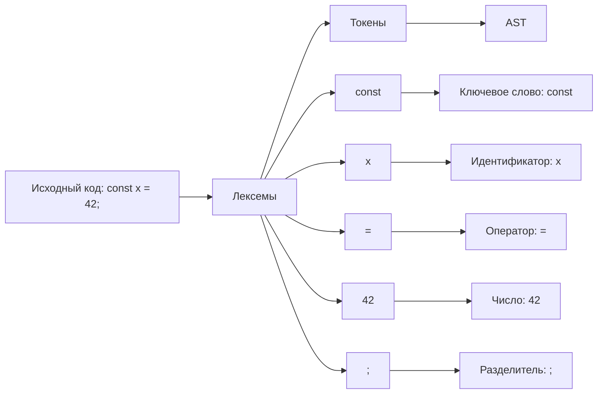
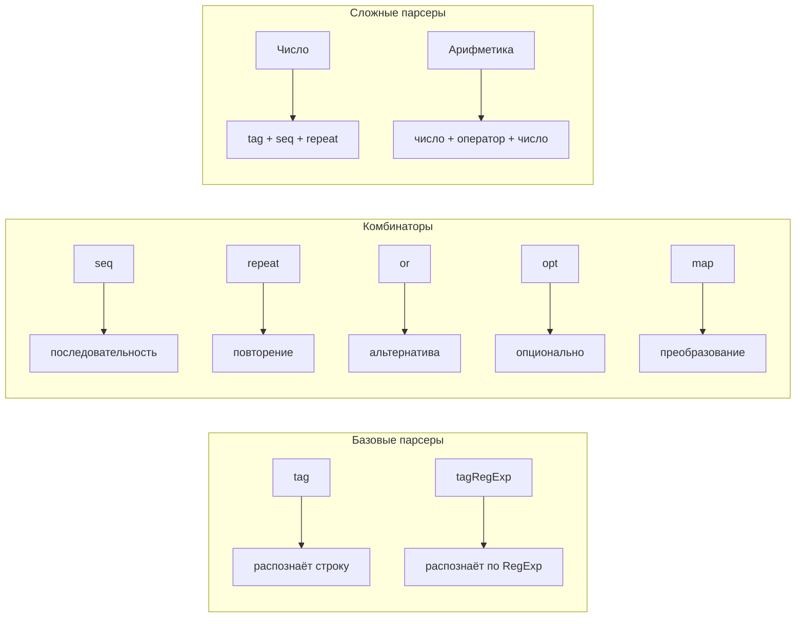

# AI конспект для лекции #26

## Вспоминаем про автоматы

**Автомат (конечный автомат)** — модель с конечным числом состояний и переходами между ними. Ранее мы рассматривали итераторы как автоматы, где каждый вызов `next()` переводит автомат в новое состояние. Парсеры — это тоже автоматы, но они читают символы из входного потока и переводят автомат в новое состояние на основе прочитанного символа.

## Парсинг данных

**Парсинг** — это процесс преобразования входных данных (обычно текста) в структурированное представление (дерево, объект, AST). Это одна из фундаментальных задач в программировании:

- Чтение конфигурационных файлов (JSON, YAML, TOML).
- Разбор языков программирования.
- Обработка данных из сети (HTTP, XML, HTML).
- Компиляция и интерпретация кода.

## Парсер языка программирования

Парсер языка программирования — это программа, которая читает исходный код и преобразует его в структурированное представление, с которым можно работать дальше (компилировать, интерпретировать, анализировать).

## Этапы парсинга языка

1. **Лексемы (lexemes)** — последовательность символов, имеющая смысл (числа, операторы, ключевые слова).
2. **Токены (tokens)** — типизированное представление лексемы: `{ type: "number", value: "42" }`,
   `{ type: "keyword", value: "if" }`.
3. **AST (Abstract Syntax Tree)** — абстрактное синтаксическое дерево, представляющее структуру программы.



## Грамматика и парсеры

**Грамматика** — это формальный набор правил, описывающих, какие последовательности символов считаются корректными в языке. Например, грамматика числа с плавающей точкой описывает, что число может состоять из целой части, точки, дробной части и экспоненты.

Обычно грамматику описывают в специальной нотации (EBNF, PEG, BNF), а затем **генераторы парсеров** (ANTLR, PEG.js, nearley) на основе этой грамматики генерируют код парсера на нужном языке программирования.

Например, **грамматика для парсера чисел с плавающей точкой**:

```
digit0    = "0".."9"
digit1    = "1".."9"
digits    = digit1 {digit0}
sign      = "+" | "-"
exp       = "e" | "E" [sign] digits
integer   = [sign] ("0" | digits)
fractional0 = "." {digit0} (min 0)
fractional1 = "." {digit0} (min 1)
floatNumber = (integer [fractional0] [exp]) | (fractional1 [exp])
```

Однако можно пойти другим путём: **описывать грамматику напрямую на языке программирования**, используя парсер-комбинаторы. Вместо того чтобы писать грамматику в отдельном файле и генерировать код, мы сразу пишем код, который является и грамматикой, и реализацией парсера одновременно.

```js
const sign = tag(/[+-]/);
const digit0 = tag(/[0-9]/);
const digit1 = tag(/[1-9]/);
const digits = seq(digit1, repeat(digit0, { min: 0 }));
const exp = seq(tag(/[eE]/), opt(sign), digits);
const integer = seq(opt(sign), or(tag("0"), digits));
const fractional0 = seq(tag("."), repeat(digit0, { min: 0 }));
const fractional1 = seq(tag("."), repeat(digit0, { min: 1 }));
const floatNumber = or(
    seq(integer, opt(fractional0), opt(exp)),
    seq(fractional1, opt(exp))
);
```

Основная идея: **описываем грамматику языка на языке программирования**. Мы создаём функции-парсеры, каждая из которых распознаёт определённый фрагмент входных данных. Затем комбинируем эти парсеры в более сложные.

## Парсер-комбинаторы

**Парсер-комбинаторы** — это подход к написанию парсеров, где:

1. Базовые парсеры распознают простые элементы (один символ, строку, регулярное выражение).
2. Комбинаторы — функции, которые принимают парсеры и возвращают новый, более сложный парсер.
3. Парсеры легко комбинируются и переиспользуются.

### Функция-парсер и итератор по данным

В нашей реализации парсер — это функция, которая принимает итератор по входным данным и возвращает результат разбора:

```typescript
type ParserResult<T> = [T, ParserIterator];
type Parser<T> = (iter: ParserIterator) => ParserResult<T>;
```

**ParserIterator** — итератор по строке, который умеет:

- `peek()` — посмотреть на текущий символ без продвижения.
- `next()` — перейти к следующему символу.
- `clone()` — создать копию итератора (для возврата при неудаче).
- `changePosition()` — изменить позицию (для ручного управления).

## Композиция через комбинаторы

Комбинаторы позволяют строить сложные парсеры из простых:

| Комбинатор                | Описание                                              |
|---------------------------|-------------------------------------------------------|
| `tag(pattern)`            | Распознаёт конкретную строку или регулярное выражение |
| `seq(...parsers)`         | Последовательное применение парсеров                  |
| `repeat(parser, options)` | Повторение парсера (от min до max раз)                |
| `opt(parser)`             | Опциональный парсер (0 или 1 раз)                     |
| `or(...parsers)`          | Альтернатива (первый успешный)                        |
| `map(parser, fn)`         | Преобразование результата парсера                     |



---

## Реализация базовых комбинаторов

### ParserIterator — итератор по строке

```typescript
export class ParserIterator {
    readonly input: string;
    #position = 0;

    constructor(input: string, position = 0) {
        this.input = input;
        this.changePosition(position);
    }

    [Symbol.iterator]() {
        return this;
    }

    peek() {
        return this.#getChar(this.position);
    }

    next() {
        const value = this.#getChar(this.position);
        if (value === undefined) {
            return { value, done: true };
        }
        this.#position += value.length;
        return { value, done: false };
    }

    changePosition(position: number) {
        this.#position = position;
    }

    clone() {
        return new ParserIterator(this.input, this.position);
    }

    #getChar(index: number): string | undefined {
        const str = this.input;
        const code = str.charCodeAt(index);

        // Поддержка суррогатных пар (эмодзи)
        if (code >= 0xD800 && code <= 0xDBFF && index + 1 < str.length) {
            const next = str.charCodeAt(index + 1);
            if (next >= 0xDC00 && next <= 0xDFFF) {
                return str.slice(index, index + 2);
            }
        }

        return str[index];
    }
}
```

### tag — фабрика парсеров

`tag` — базовый парсер, распознающий строку или регулярное выражение:

```typescript
export function tag(pattern: Iterable<string | RegExp> | RegExp): Parser<string> {
    const patterns = pattern instanceof RegExp ? [pattern] : [...pattern];

    return (iter) => {
        let result = "";

        for (const test of Iterator.from(patterns).flatMap(flat).map(createTest)) {
            const char = iter.peek();
            if (char == null || !test(char)) {
                throw new Error(`Expected pattern "${[...patterns].join("")}"`);
            }
            result += char;
            iter.next();
        }

        return [result, iter];
    };
}
```

**Пример использования:**

```typescript
const parser = tag("hello");
const [result, iter] = parser(new ParserIterator("hello world"));
console.log(result); // "hello"
```

### seq — последовательность

`seq` применяет несколько парсеров последовательно, возвращая массив результатов:

```typescript
export function seq<T extends Parser<any>[]>(...parsers: T): Parser<{
    [K in keyof T]: ReturnType<T[K]>[0];
}> {
    return (iter) => {
        const results = [];
        for (const parser of parsers) {
            try {
                const [result, nextIter] = parser(iter.clone());
                iter = nextIter;
                results.push(result);
            } catch (cause) {
                throw new Error("Expected sequence", { cause });
            }
        }
        return [results, iter] as any;
    };
}
```

**Пример использования:**

```typescript
const parser = seq(tag("Hello"), tag(" "), tag("World"));
const [result] = parser(new ParserIterator("Hello World"));
console.log(result); // ["Hello", " ", "World"]
```

### repeat — повторение

`repeat` повторяет парсер указанное число раз:

```typescript
export interface RepeatOptions {
    min?: number;
    max?: number;
}

export function repeat<T>(parser: Parser<T>, { min = 1, max = Infinity }: RepeatOptions = {}): Parser<T[]> {
    return (iter) => {
        const results = [];
        let count = 0;

        while (count < max) {
            try {
                const [result, nextIter] = parser(iter.clone());
                iter = nextIter;
                results.push(result);
                count++;
            } catch {
                if (count >= min) break;
                throw new Error(`Expected at least ${min} matches, got ${count}`);
            }
        }

        return [results, iter];
    };
}
```

**Пример использования:**

```typescript
const parser = repeat(tag(/\d/), { min: 1 });
const [result] = parser(new ParserIterator("123abc"));
console.log(result); // ["1", "2", "3"]
```

### opt — опциональный парсер

`opt` — частный случай `repeat` с `min: 0, max: 1`:

```typescript
export function opt<T>(parser: Parser<T>): Parser<T[]> {
    return repeat(parser, { min: 0, max: 1 });
}
```

### or — альтернатива

`or` пробует парсеры по порядку и возвращает результат первого успешного:

```typescript
export function or<T extends Parser<any>[]>(...parsers: T): Parser<
    T extends (infer R extends Parser<any>)[] ? ReturnType<R>[0] : never
> {
    return (iter) => {
        let cause;
        for (const parser of parsers) {
            try {
                return parser(iter.clone());
            } catch (err) {
                cause = err;
            }
        }
        throw new Error("Expected one of the alternatives", { cause });
    };
}
```

**Пример использования:**

```typescript
const parser = or(tag("true"), tag("false"), tag("null"));
const [result] = parser(new ParserIterator("true"));
console.log(result); // "true"
```

### map — преобразование результата

`map` преобразует результат парсера через функцию:

```typescript
export function map<I, O>(
    parser: Parser<I>,
    mapFn: (...args: ParserResult<I>) => ParserResult<O>
): Parser<O> {
    return (iter) => mapFn(...parser(iter));
}
```

---

## Итоги лекции

- **Грамматика** — формальный набор правил, описывающих корректные последовательности символов. Обычно генераторы парсеров создают код на основе грамматики, но при подходе парсер-комбинаторов грамматика пишется непосредственно на языке программирования.

- **Парсер** — функция, преобразующая входные данные (обычно текст) в структурированное представление (дерево, объект, AST).

- **Парсер-комбинаторы** — подход, где парсеры собираются из более простых с помощью комбинаторов. Это позволяет описывать грамматику прямо в коде и легко модифицировать её без переключения между инструментами.

- **Комбинаторы ленивы** — они не выполняют парсинг до вызова парсера. Это позволяет строить сложные грамматики без немедленных вычислений.

- **Итераторы** — основа для поточного парсинга: данные читаются по мере необходимости, что позволяет экономить память и работать с большими объёмами данных.

- **Backtracking (возврат)** — при неудаче парсер может откатиться к предыдущей позиции благодаря клонированию итератора или запоминания позиции.